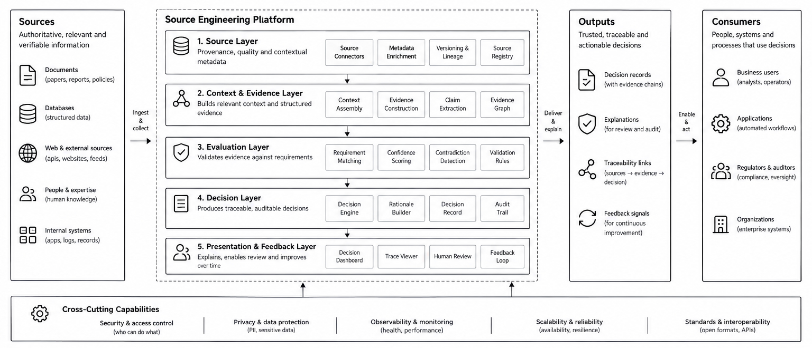

# Source Engineering

> An engineering discipline for grounding AI-based decisions with integrity.

Source Engineering establishes the engineering principles, models, architectures, and controls required to connect decisions to relevant, verifiable, and traceable sources of evidence.

Its purpose is not merely to retrieve information or produce explanations. It is to establish an inspectable relationship between the sources available to a system, the evidence assembled from those sources, the context in which that evidence is evaluated, and the decisions ultimately produced.

Read the foundational essay · Explore the GitHub organization

## The discipline

AI-based decisions are only as defensible as the evidence, context, and controls supporting them.

Source Engineering addresses this engineering problem by making source integrity, evidence construction, contextual validity, decision accountability, and traceability explicit properties of a system. It treats grounding as an engineering responsibility rather than a prompting technique or an incidental feature of a model.

The discipline brings together:

- Source integrity: identifying sources, their origins, versions, authority, and relevant limitations.
- Evidence construction: connecting claims and observations to their supporting and contradicting evidence.
- Contextual validity: evaluating evidence against the scope, circumstances, and time of a decision.
- Decision accountability: recording the declared basis for a decision, its constraints, and unresolved evidential gaps.
- Traceability: preserving the relationships required to inspect, review, and reconstruct a decision's evidential basis.
- Continuous validation: identifying changes, failures, and weaknesses that require reassessment.

These concerns apply across model-assisted decisions, automated workflows, enterprise applications, and systems in which decisions must be reviewed or audited.

## Reference architecture

The reference architecture describes how Source Engineering can be implemented as an end-to-end engineering system, from source acquisition to decision delivery, review, and feedback.

The architecture is a reference model, not a mandate to adopt a particular vendor, model, framework, or deployment topology.

### The engineering lifecycle

The architecture is organised around five layers, with cross-cutting capabilities that apply across all of them.

| Layer | Responsibility |
|-------|----------------|
| 01. Source | Acquire source material; establish provenance, quality, metadata, versioning, and lineage. |
| 02. Context and evidence | Assemble relevant context; construct evidence; extract claims; represent evidence relationships. |
| 03. Evaluation | Evaluate evidence against declared requirements; detect contradictions; apply validation rules. |
| 04. Decision | Produce decisions with a recorded evidential basis, rationale, decision record, and audit trail. |
| 05. Presentation and feedback | Enable inspection, human review, traceability, and feedback-driven improvement. |

Security and access control, privacy and data protection, observability and monitoring, scalability and reliability, and standards and interoperability apply across the lifecycle rather than belonging to any single layer.

### The architecture in context

Sources feed the platform: authoritative, relevant, and verifiable information drawn from documents, databases, web and external sources, people and expertise, and internal systems. The platform delivers traceable, accountable decisions to four kinds of consumer: business users, applications, regulators and auditors, and organisations.

The tagline on the diagram reads: **from sources to trust**.

## Levels of authority

The organisation communicates three levels of authority distinctly.

- **Intellectual authority** -- the definition, principles, and research agenda. Housed in foundations and research.
- **Technical authority** -- the formal models, specifications, architecture, and governed releases. Housed in model, specifications, and architecture.
- **Empirical authority** -- reproducible evaluations, conformance evidence, implementation experience, and independent review. Housed in conformance, reference implementation, case studies, and tools.

That distinction is what makes the profile more than a polished landing page.

## Discipline repositories

Source Engineering is developed through a collection of repositories with explicit artefact ownership. Each repository has one authoritative responsibility. Other repositories reference its outputs rather than maintaining competing copies of canonical definitions or specifications.

### Foundations and governance

| Repository | Responsibility |
|------------|----------------|
| [project-governance](https://github.com/Source-Engineering/project-governance) | Change process, ADRs, RFCs, maintainer responsibilities, and release policy. |
| [source-engineering-foundations](https://github.com/Source-Engineering/source-engineering-foundations) | Discipline definition, principles, terminology, scope, and non-goals. |
| [source-engineering-research](https://github.com/Source-Engineering/source-engineering-research) | Research questions, hypotheses, experimental protocols, and findings. |

### Models, specifications, and architecture

| Repository | Responsibility |
|------------|----------------|
| [source-engineering-model](https://github.com/Source-Engineering/source-engineering-model) | Canonical conceptual and data model. |
| [source-engineering-specifications](https://github.com/Source-Engineering/source-engineering-specifications) | Normative requirements, technical contracts, and specification releases. |
| [source-engineering-architecture](https://github.com/Source-Engineering/source-engineering-architecture) | Reference architecture, blueprint stack, and interface contracts. |

### Implementation and assurance

| Repository | Responsibility |
|------------|----------------|
| [source-engineering-reference-implementation](https://github.com/Source-Engineering/source-engineering-reference-implementation) | Working implementation demonstrating the specifications. |
| [source-engineering-conformance](https://github.com/Source-Engineering/source-engineering-conformance) | Validation harness, test suites, test vectors, and conformance criteria. |
| [source-engineering-tools](https://github.com/Source-Engineering/source-engineering-tools) | Reusable engineering utilities, command-line tools, visualisers, and SDKs. |

### Practice and adoption

| Repository | Responsibility |
|------------|----------------|
| [source-engineering-practice](https://github.com/Source-Engineering/source-engineering-practice) | Implementation guides, engineering patterns, and operational playbooks. |
| [source-engineering-education](https://github.com/Source-Engineering/source-engineering-education) | Curriculum, learning paths, exercises, and assessment materials. |
| [source-engineering-case-studies](https://github.com/Source-Engineering/source-engineering-case-studies) | Evaluated demonstrations, reproducible examples, and documented outcomes. |

The `project-governance` repository is the canonical entry point for the change process. The `source-engineering` repository retains the public introduction, navigation, and org-level portal at the discipline top level.

## How the discipline evolves

Source Engineering should evolve through explicit proposals, technical review, and evidence-backed changes.

The governance process distinguishes foundational changes, normative specification changes, architectural decisions, implementation changes, and experimental research.

Changes to canonical definitions and technical contracts are reviewed in their authoritative repositories. Implementations and conformance tests evolve against versioned specifications.

The objective is to maintain conceptual coherence while allowing the discipline to improve through research, implementation experience, and independent scrutiny.

Start with the governance repository to understand the change process.

## Contributing

Source Engineering is intended to be open to technical scrutiny and contributions.

You can contribute by:

- Reviewing the discipline's principles and foundational definitions.
- Proposing changes to models, specifications, and architecture.
- Implementing reference components and reusable tools.
- Developing conformance tests and reproducible evaluations.
- Publishing research findings and documented case studies.
- Improving practitioner guidance and educational material.

Begin with the repository that owns the artefact you want to change. Use its contribution guidance and the organisation's governance process for changes that affect multiple parts of the discipline.

## Foundational writing

- [Source Engineering: Grounding AI-Based Decisions with Integrity](https://nuel.otchere.com/posts/2025/12/source-engineering-grounding-ai-based-decisions-with-integrity.html)
- [Reframing the Five Pillars, One Year Later](https://nuel.otchere.com/posts/2026/10/reframing-the-five-pillars-one-year-later.html)

The essays establish the intellectual direction. The repositories progressively translate that direction into formal models, engineering contracts, implementations, and evaluable practice.

## Foundational concepts

The 2025 essay introduced a four-layer stack (Typed Model, Runtime Validation, Business Guardrails, Audit Trail) and the Chain of Orchestrable and Traceable Sources (COTS) contract. The 2026 reframing composes these into the broader five-layer architecture presented above. The four-layer stack describes key implementation controls within the five-layer lifecycle; COTS is the structured unit of accountability that records inputs, context, decisions, evidence, and validation for a response. Both remain foundational concepts of the discipline; their normative definitions and machine-readable representations belong in the specifications repository.

## Guiding principle

From sources to evidence. From evidence to decisions. From decisions to accountable outcomes.

Source Engineering exists to make that chain an explicit engineering concern.

## Licence

Apache-2.0. See [LICENSE](../LICENSE).
