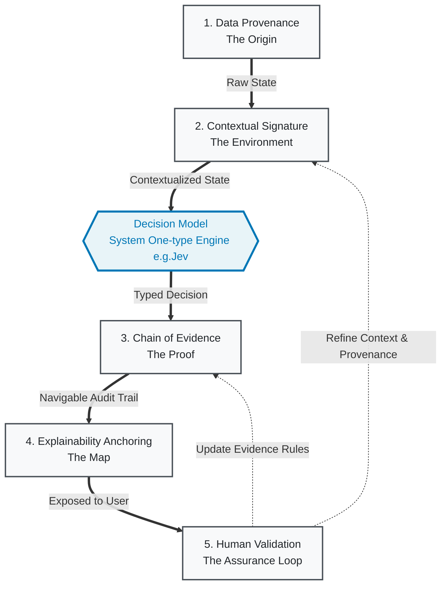

# Source Engineering

> An engineering discipline for grounding AI-based decisions with integrity.

Source Engineering establishes the engineering principles, models, architectures, and controls required to connect decisions to relevant, verifiable, and traceable sources of evidence.

Its purpose is not merely to retrieve information or produce explanations. It is to establish an inspectable relationship between the sources available to a system, the evidence assembled from those sources, the context in which that evidence is evaluated, and the decisions ultimately produced.

Read the foundational essay · Explore the GitHub organization

## The discipline

AI-based decisions are only as defensible as the evidence, context, and controls supporting them.

Source Engineering addresses this engineering problem by making source integrity, evidence construction, contextual validity, decision accountability, and traceability explicit properties of a system. It treats grounding as an engineering responsibility rather than a prompting technique or an incidental feature of a model.

The discipline brings together:

- Source integrity: identifying sources, their origins, versions, authority, and relevant limitations.
- Evidence construction: connecting claims and observations to their supporting and contradicting evidence.
- Contextual validity: evaluating evidence against the scope, circumstances, and time of a decision.
- Decision accountability: recording the declared basis for a decision, its constraints, and unresolved evidential gaps.
- Traceability: preserving the relationships required to inspect, review, and reconstruct a decision's evidential basis.
- Continuous validation: identifying changes, failures, and weaknesses that require reassessment.

These concerns apply across model-assisted decisions, automated workflows, enterprise applications, and systems in which decisions must be reviewed or audited.

## Reference architecture and the C.O.T.S Framework

The reference architecture describes how Source Engineering can be implemented as an end-to-end engineering system, from source acquisition to decision delivery, review, and feedback.

The architecture is a reference model, not a mandate to adopt a particular vendor, model, framework, or deployment topology.
----
Here is the formalized, reusable version of the **C.O.T.S. Framework** (Chain of Orchestrable and Traceable Sources). It has been structured as a practical, referenceable model for AI engineers, architects, and product leaders to implement verifiable AI decision-making in production systems.

---

## The C.O.T.S. Framework 
#### *(Chain of Orchestrable and Traceable Sources)*

**Definition:**  
C.O.T.S. Framework is a systematic methodology for grounding AI-based decisions with integrity. It transforms opaque, "black-box" AI outputs into verifiable, auditable, and human-aligned reasoning pathways by establishing a strict, multi-stage feedback loop between data ingestion, contextual orientation, decision execution, and human validation.

**Core Philosophy:**  
AI Software & Service engineering must shift from prompting models to *"produce an answer"*, to orchestrating systems that can *"prove why an answer was chosen" consistently.*

---

### 5 Core Pillars of C.O.T.S.

#### 1. Data Provenance Tracking (The "Origin")
* **Concept:** Every AI decision must have an immutable digital history. 
* **Implementation:** Automatically log the exact origin of every input used by the model. This includes the raw prompt, retrieved data chunks (RAG), system configurations, model version, and timestamp. 
* **Output:** A cryptographically hashed or strictly versioned "Input Manifest" attached to every transaction.

#### 2. Contextual Signature Mapping (The "Environment")
* **Concept:** A decision is only as good as its context. The system must understand *who* is asking, *when*, and *under what conditions*.
* **Implementation:** Develop automated methods to map user context (role, location, historical interactions, time-sensitivity) to specific data subsets and operational parameters. This data dynamically optimizes the model’s inferencing settings (e.g., temperature, entropy, routing paths) in real-time.
* **Output:** A "Contextual Signature" object that travels with the request, ensuring the model's behavior is bounded by the specific scenario.

#### 3. Chain of Evidence Generation (The "Proof")
* **Concept:** Move beyond free-text "Chain of Thought" (which is hard to parse and prone to hallucination) to structured, machine-readable proof.
* **Implementation:** For every model output, the system automatically generates a structured list of supporting data points, citations, and contextual factors that directly link back to the Input Manifest. 
* **Output:** A structured JSON/Knowledge Graph node (e.g., `{ "decision": "X", "confidence": 0.92, "supporting_evidence_ids": ["doc_12", "rule_4A"] }`).

#### 4. Explainability Anchoring (The "Map")
* **Concept:** Reasoning must be navigable, not just stated. 
* **Implementation:** Integrate workflow orchestration tools to visually and programmatically trace dynamic operations as "breadcrumbs." This creates a digital reasoning roadmap that allows developers and auditors to click through the exact sequence of data points, tool calls, and model invocations that led to the final output.
* **Output:** An interactive audit trail or "Reasoning Roadmap" UI/dashboard for internal review and compliance.

#### 5. Human Validation Points (The "Loop")
* **Concept:** Trust is built through interactive scrutiny, not passive consumption.
* **Implementation:** Expose "evidence-aware" feedback mechanisms directly to the end-user or human-in-the-loop. Allow users to probe the model’s reasoning, highlight specific data points in the Chain of Evidence, suggest alternative contexts, and flag inconsistencies.
* **Output:** Structured, unsolicited/solicited feedback that is fed back into the system to refine future Contextual Signatures and model fine-tuning, closing the OODA (Observe-Orient-Decide-Act) loop.

---

### Operational Lifecycle (OODA Derived & Integrated)

To make this framework actionable, it maps directly to the military-derived **OODA Loop**, adapted for AI engineering:

1. **OBSERVE:** Ingest the user request. Trigger **Data Provenance Tracking** to snapshot the raw state and inputs.
2. **ORIENT:** Apply **Contextual Signature Mapping** to tailor the environment, retrieve relevant data, and set model parameters.
3. **DECIDE:** Execute the AI model (ideally a fast, structured decision model like TypeSafe’s Jev). Simultaneously trigger **Chain of Evidence Generation** to bind the output to its supporting data.
4. **ACT & AUDIT:** Present the decision alongside its **Explainability Anchoring**. Provide **Human Validation Points** for the user to accept, reject, or query the decision, logging the result for continuous improvement.

---

### Implementation Checklist for Engineering Teams

Use this checklist to audit or build your AI pipelines:

- [ ] **Input Logging:** Does every AI call log the exact model version, prompt, and retrieved context IDs?
- [ ] **Context Binding:** Is user/session context explicitly passed as a structured object, not just baked into a text prompt?
- [ ] **Structured Output:** Does the model return a structured schema (e.g., via Pydantic/JSON) that includes confidence scores and evidence references, rather than just raw text?
- [ ] **Traceability:** Can an engineer click a button in our logging system (e.g., Langfuse, Arize) and see the exact data chunks that led to a specific decision?
- [ ] **User Feedback:** Does the UI expose the "why" to the user, allowing them to flag specific parts of the reasoning as incorrect or biased?

---

### Measuring Success: C.O.T.S. Metrics

To prove the framework is working, track these key metrics:
1. **Evidence Coverage Rate:** % of AI decisions that successfully return a complete, linked Chain of Evidence.
2. **Hesitation Factor Reduction:** Measured via user analytics (e.g., decrease in manual overrides, increase in "accept" rates for AI-suggested actions).
3. **Audit Resolution Time:** Time required for a human reviewer to validate or debug an AI decision (should decrease significantly with Explainability Anchoring).
4. **Feedback Loop Velocity:** Time taken for user-validated corrections to be incorporated into system prompts, routing rules, or fine-tuning datasets.

---

### Feasibility (The "Jev" & Decision Models Catalyst)

Historically, implementing C.O.T.S. with traditional, autoregressive LLMs was a bottleneck. Generating detailed Chains of Thought, parsing them for evidence, and running multiple contextual checks was too slow and expensive for real-time applications. 

The emergence of **System One models** (like TypeSafe’s Jev) acts as a catalyst for the C.O.T.S. framework. Because these models are designed to output *typed, calibrated decisions with probabilities* in milliseconds, they natively satisfy Pillars 1, 3, and 4 without the overhead of text generation. They make the rigorous, multi-stage auditing demanded by C.O.T.S. economically and computationally viable at scale.

*This framework is derived from the foundational thought leadership of "Source Engineering" (2025). It is provided as an open, reusable mental model for the AI engineering community to build systems that prioritize integrity, auditability, and human-AI collaboration.*

#### Source Engineering lifecycle

The architecture is organised around five layers, with cross-cutting capabilities that apply across all of them.

| Layer | Responsibility |
|-------|----------------|
| 01. Source | Acquire source material; establish provenance, quality, metadata, versioning, and lineage. |
| 02. Context and evidence | Assemble relevant context; construct evidence; extract claims; represent evidence relationships. |
| 03. Evaluation | Evaluate evidence against declared requirements; detect contradictions; apply validation rules. |
| 04. Decision | Produce decisions with a recorded evidential basis, rationale, decision record, and audit trail. |
| 05. Presentation and feedback | Enable inspection, human review, traceability, and feedback-driven improvement. |

_Security and access control, privacy and data protection, observability and monitoring, scalability and reliability, and standards and interoperability apply across the lifecycle rather than belonging to any single layer._

## The architecture in context

Sources feed the platform: authoritative, relevant, and verifiable information drawn from documents, databases, web and external sources, people and expertise, and internal systems. The platform delivers traceable, accountable decisions to four kinds of consumer: business users, applications, regulators and auditors, and organisations.

The tagline on the diagram reads: **from sources to trust**.

### Levels of authority

The organisation communicates three levels of authority distinctly.

- **Intellectual authority** -- the definition, principles, and research agenda. Housed in foundations and research.
- **Technical authority** -- the formal models, specifications, architecture, and governed releases. Housed in model, specifications, and architecture.
- **Empirical authority** -- reproducible evaluations, conformance evidence, implementation experience, and independent review. Housed in conformance, reference implementation, case studies, and tools.

That distinction is what makes the profile more than a polished landing page.

## Discipline repositories

Source Engineering is developed through a collection of repositories with explicit artefact ownership. Each repository has one authoritative responsibility. Other repositories reference its outputs rather than maintaining competing copies of canonical definitions or specifications.

### Foundations and governance

| Repository | Responsibility |
|------------|----------------|
| [project-governance](https://github.com/Source-Engineering/project-governance) | Working home, change process, ROADMAP, and canonical entry point. |
| [source-engineering-governance](https://github.com/Source-Engineering/source-engineering-governance) | Governance charter, ADRs, RFCs, maintainer responsibilities, and release policy. |
| [source-engineering-foundations](https://github.com/Source-Engineering/source-engineering-foundations) | Discipline definition, principles, terminology, scope, and non-goals. |
| [source-engineering-research](https://github.com/Source-Engineering/source-engineering-research) | Research questions, hypotheses, experimental protocols, and findings. |

### Models, specifications, and architecture

| Repository | Responsibility |
|------------|----------------|
| [source-engineering-model](https://github.com/Source-Engineering/source-engineering-model) | Canonical conceptual and data model. |
| [source-engineering-specifications](https://github.com/Source-Engineering/source-engineering-specifications) | Normative requirements, technical contracts, and specification releases. |
| [source-engineering-architecture](https://github.com/Source-Engineering/source-engineering-architecture) | Reference architecture, blueprint stack, and interface contracts. |

### Implementation and assurance

| Repository | Responsibility |
|------------|----------------|
| [source-engineering-reference-implementation](https://github.com/Source-Engineering/source-engineering-reference-implementation) | Working implementation demonstrating the specifications. |
| [source-engineering-conformance](https://github.com/Source-Engineering/source-engineering-conformance) | Validation harness, test suites, test vectors, and conformance criteria. |
| [source-engineering-tools](https://github.com/Source-Engineering/source-engineering-tools) | Reusable engineering utilities, command-line tools, visualisers, and SDKs. |

### Practice and adoption

| Repository | Responsibility |
|------------|----------------|
| [source-engineering-practice](https://github.com/Source-Engineering/source-engineering-practice) | Implementation guides, engineering patterns, and operational playbooks. |
| [source-engineering-education](https://github.com/Source-Engineering/source-engineering-education) | Curriculum, learning paths, exercises, and assessment materials. |
| [source-engineering-case-studies](https://github.com/Source-Engineering/source-engineering-case-studies) | Evaluated demonstrations, reproducible examples, and documented outcomes. |

The `project-governance` repository is the canonical entry point for the change process, and the `source-engineering-governance` repository holds the governance charter, ADRs, and RFCs.

## How the discipline evolves

Source Engineering should evolve through explicit proposals, technical review, and evidence-backed changes.

The governance process distinguishes foundational changes, normative specification changes, architectural decisions, implementation changes, and experimental research.

Changes to canonical definitions and technical contracts are reviewed in their authoritative repositories. Implementations and conformance tests evolve against versioned specifications.

The objective is to maintain conceptual coherence while allowing the discipline to improve through research, implementation experience, and independent scrutiny.

Start with `project-governance` for the working home, the change process, and the ROADMAP. The governance charter, ADRs, and RFCs live in `source-engineering-governance`.

## Contributing

Source Engineering is intended to be open to technical scrutiny and contributions.

You can contribute by:

- Reviewing the discipline's principles and foundational definitions.
- Proposing changes to models, specifications, and architecture.
- Implementing reference components and reusable tools.
- Developing conformance tests and reproducible evaluations.
- Publishing research findings and documented case studies.
- Improving practitioner guidance and educational material.

Begin with the repository that owns the artefact you want to change. Use its contribution guidance and the organisation's governance process for changes that affect multiple parts of the discipline.

## Foundational writing

- [Source Engineering: Grounding AI-Based Decisions with Integrity](https://nuel.otchere.com/posts/2025/12/source-engineering-grounding-ai-based-decisions-with-integrity.html)
- [Reframing the Five Pillars, One Year Later](https://nuel.otchere.com/posts/2026/10/reframing-the-five-pillars-one-year-later.html)

The essays establish the intellectual direction. The repositories progressively translate that direction into formal models, engineering contracts, implementations, and evaluable practice.

## Foundational concepts

The 2025 essay introduced a four-layer stack (Typed Model, Runtime Validation, Business Guardrails, Audit Trail) and the Chain of Orchestrable and Traceable Sources (COTS) contract. The 2026 reframing composes these into the broader five-layer architecture presented above. The four-layer stack describes key implementation controls within the five-layer lifecycle; COTS is the structured unit of accountability that records inputs, context, decisions, evidence, and validation for a response. Both remain foundational concepts of the discipline; their normative definitions and machine-readable representations belong in the specifications repository.

## Guiding principle

From sources to evidence. From evidence to decisions. From decisions to accountable outcomes.

Source Engineering exists to make that chain an explicit engineering concern.

## Licence

Apache-2.0. See [LICENSE](../LICENSE).
